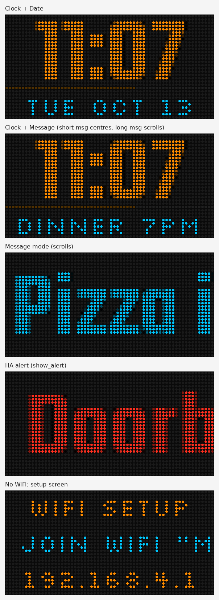

# esp32-matrix-clock

Standalone WiFi clock, weather and message board for the **AZSMZ ESP32 Matrix** controller driving a **64×32 HUB75** RGB LED panel. Built on [ESPHome](https://esphome.io) (2026.9+, native `hub75` display). No Home Assistant, cloud account or API key required.



## Features

- **Dog + Weather** (the default screen):
  - A pixel-art dog on the left.
  - On the right, the time, then the current weather for a US ZIP code (an icon and the temperature), then your scroll text.
- **Weather** comes from [Open-Meteo](https://open-meteo.com), which is free and needs no key. It refreshes every 15 minutes, and immediately when you change the ZIP.
- **Clock screens:**
  - **Clock + Message** and **Clock + Date** show a big clock from NTP (America/Chicago), 12/24-hour, with a seconds bar.
  - **Message** shows the scroll text in a large font.
- **Scroll text** is set in the web UI. It is centred when it fits and scrolls when it doesn't. Leave it empty to show the weather location, conditions and date instead.
- **Alerts:** a red pop-up for N seconds, set from the web UI or with one `curl`.
- **Web UI** at `http://matrix-clock.local` (or the device IP), with a REST endpoint for every control.
- **WiFi setup on the device itself.** With no known network, it starts a password-protected hotspot and captive portal, and the panel shows how to join.
- **Buttons:** the on-board Flash button, plus one external button on IO21 (click, double-click and hold). Both cycle through the screens.
- **Encrypted OTA updates** after the first USB flash.
- Settings (message, mode, brightness, 12/24h) survive reboots, and the clock keeps running through WiFi drop-outs.

## Hardware

| Part | Notes |
|---|---|
| AZSMZ ESP32 Matrix board | ESP32-WROOM-32 (ESP32-D0WDQ6, 4 MB flash), CH340 USB-serial, microSD slot, HUB75 socket. [Vendor repo](https://github.com/cxandy/AZSMZ-ESPMatrixPanel) |
| 64×32 HUB75 panel | 1/16 scan. The E line is not used. |
| 5 V supply, 4 A | Powers the board through the screw terminal and the panel through its own lead. See [Power](#power). |

### Pin map (verified on real hardware)

| HUB75 | GPIO | | HUB75 | GPIO |
|---|---|---|---|---|
| R1 | 17 | | R2 | 4 |
| G1* | 16 | | G2* | 12 |
| B1* | 2 | | B2* | 15 |
| A | 26 | | B | 13 |
| C | 14 | | D | 27 |
| CLK | 25 | | LAT | 33 |
| OE | 32 | | E | (22, unused) |

Two quirks were found on the test unit:

1. **The board revision label doesn't match its wiring.** The board is silkscreened **V1.2**, but its address and B2 lines follow the vendor's **V1.5** table (B=IO13, D=IO27, B2=IO12). With the V1.2 table, rows render on the wrong lines.
2. **The panel swaps green and blue (RBG order).** \*So G and B are crossed in the config. For a standard RGB panel, use `g1=GPIO2, b1=GPIO16, g2=GPIO15, b2=GPIO12`.

If text lands on the wrong rows, the address pins are wrong. If orange shows as pink/magenta, swap G and B.

## First flash (USB)

Requires Python 3.12+.

```bash
git clone https://github.com/lionelfelix-ssai/esp32-matrix-clock
cd esp32-matrix-clock
cp secrets.example.yaml secrets.yaml   # set the hotspot password and OTA key
uv venv --python 3.13 .venv && uv pip install --python .venv/bin/python "esphome==2026.9.1"
.venv/bin/esphome run matrix-clock.yaml   # pick the USB serial port
```

The first build downloads the ESP-IDF toolchain, which takes several minutes. Auto-reset works, so you don't need to press any buttons. If uploads fail with serial errors, add `--upload_speed 115200`; this board's CH340 is unreliable above that.

Restoring the vendor's demo firmware: flash `FastLED_Functions_2x_merged.bin` from the vendor repo at `0x0` with `esptool`.

## WiFi setup

1. Power it up. If it can't reach a known network, the panel shows **WIFI SETUP** after about a minute.
2. On a phone, join the hotspot **Matrix Clock Setup** using the `ap_password` from `secrets.yaml`. The password is deliberately not shown on the panel.
3. The captive portal opens. If it doesn't, browse to `192.168.4.1`. Pick the network and enter its password.

Credentials are stored on the device. Moving it to a new network repeats the same flow automatically. You can also set WiFi over USB from [web.esphome.io](https://web.esphome.io) (Improv Serial).

## Using it

Open `http://matrix-clock.local` (or the IP shown in your router). Every control also has a REST endpoint:

```bash
H=http://matrix-clock.local
curl -d "" "$H/text/Scroll%20text/set?value=Dinner%20at%207"       # scrolling line
curl -d "" "$H/text/Weather%20ZIP/set?value=78701"                # weather location
curl    "$H/text_sensor/Weather"                                  # e.g. "Austin: 94°F, Partly cloudy"
curl -d "" "$H/text/Alert/set?value=Doorbell"                     # red pop-up
curl -d "" "$H/number/Alert%20seconds/set?value=20"               # alert duration
curl -d "" "$H/select/Display%20mode/set?option=Dog%20%2B%20Weather"
curl -d "" "$H/number/Brightness/set?value=120"                   # 5-255
curl -d "" "$H/switch/24-hour%20clock/turn_on"
```

POSTs need a body (`-d ""`). Without one, the server rejects the request for a missing Content-Length.

| Display mode | What's on it |
|---|---|
| **Dog + Weather** (default) | Dog on the left. On the right: time, weather icon and temperature, then the scroll text clipped to the right half |
| **Clock + Message** | Big clock and seconds bar, with the scroll text underneath (the date if it's empty) |
| **Clock + Date** | Big clock and seconds bar, with the date |
| **Message** | Scroll text in the large font |

## Weather

- **How it works:** the device looks up the ZIP code once with Open-Meteo's geocoder, then fetches the current temperature (°F), WMO weather code and day/night every 15 minutes.
- **Checking it:** the read-only **Weather** entity in the web UI shows what it last got, e.g. "Austin: 94°F, Partly cloudy".
- **Icons:** clear (sun or moon), partly cloudy (day or night), cloudy, fog, rain (drizzle, rain and showers), snow and thunderstorm.
- **Brief pauses:** requests run in ESPHome's main loop, and the original ESP32 takes a few seconds per HTTPS handshake. The scroll pauses for about 3 seconds per refresh, and about 6 seconds when the ZIP changes. Free heap stays around 150 KB.

## Images

Panel art lives in `images/`. The source dogs are 64×64 pixel art. `tools/prep_image.py` turns any image into panel-ready art:

- It downscales with nearest-neighbour, which keeps pixel art crisp.
- It lifts dark tones. Without that, the panel's CIE1931 gamma turns near-black (like the dog's black saddle) into off LEDs.
- It flattens transparency onto black.

```bash
.venv/bin/python tools/prep_image.py images/dog-1.png images/dog-1-32.png --size 32x32
```

Then reference the new file in the `image:` block of `matrix-clock.yaml` and run an OTA update. The weather icons in `images/weather/` are 8×8 and hand-drawn.

## Buttons

| Button | Action |
|---|---|
| On-board **Flash** (IO0) | Click: next screen |
| External, **IO21 to 3.3V** (4-pin header: GND, GND, IO21, 3.3V) | Click: next screen. Double-click: previous screen. Hold 1 s: brightness low/medium/high |

IO21 is the only spare GPIO on the board; everything else is used by the panel or the SD slot. The firmware reads IO21 with a pull-down, so the switch goes between IO21 and 3.3V; that's how the test unit is wired. To wire it to GND instead, change the pin to `pullup: true` and `inverted: true`. The Flash button also has through-hole pads if you want to mount a front-panel button there. Don't hold Flash while powering up, because that enters the bootloader.

## Power

- Use a **5 V, 4 A** supply into the board's screw terminal, and run the panel's power lead to the same supply.
- A clock at the default brightness draws well under 1 A. Full-colour images at high brightness can draw 3–4 A.
- **Don't run the panel from USB.** It browns out the port and the CH340 drops off the bus.
- Unplug USB when running from the supply. Updates go over WiFi, and the isolation between USB 5 V and the terminal hasn't been verified.

## Updating (OTA)

```bash
.venv/bin/esphome run matrix-clock.yaml --device matrix-clock.local   # or the IP
```

OTA is encrypted with `ota_key` from `secrets.yaml`, and the web server's plaintext OTA endpoint is disabled.

## Design notes

- **No Bluetooth.** On the original ESP32, the BLE stack and the HUB75 DMA buffers don't fit in RAM together. BLE failed to start, and free heap fell to about 80 bytes. Without BLE, and with `sram1_as_iram`, free heap is about 150 KB.
- **No Home Assistant API.** It's a standalone device. With the API enabled, ESPHome reboots every 15 minutes when no client connects.
- **WiFi `reboot_timeout: 0s`** keeps the clock running and keeping time if the network goes away.
- **Smooth scrolling:** ESPHome's default display `update_interval` is 1 s, which makes scrolling text jump about 30 px at a time.
  - The display now redraws every 30 ms (about 33 fps), and scrolling advances exactly 1 px every 2 frames (about 16 px/s), so every step is the same size. Change the last argument of the `line()`/`scroll_in()` calls to adjust the speed (1 = twice as fast).
  - `bit_depth: 7` doubles the panel refresh from 76 Hz to 152 Hz, so frames land evenly. It also frees about 30 KB of DMA RAM.
  - The scroll still pauses for a few seconds during each weather fetch.

## License

MIT
